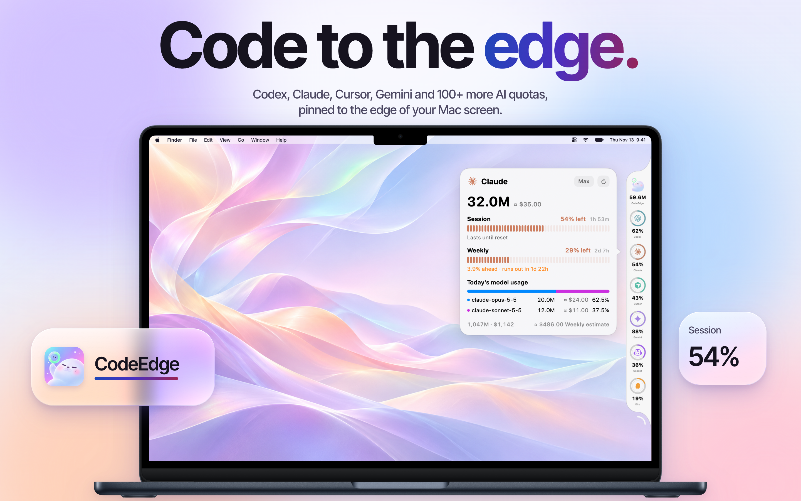

<div align="center">

<a href="https://github.com/Seaony/CodeEdge/releases/latest"></a>

# CodeEdge

### Code to the edge.

**Codex, Claude, Cursor, Gemini, Copilot, Kiro and 100+ more, pinned to the edge of your screen.**<br>
Remaining quota, reset times, today's tokens and estimated spend,<br>
without opening a single dashboard.

[](https://github.com/Seaony/CodeEdge/releases/latest) [](https://github.com/Seaony/CodeEdge/stargazers)<br>
  

**[Download](https://github.com/Seaony/CodeEdge/releases/latest)** &nbsp;·&nbsp; **[Releasing](docs/RELEASING.md)** &nbsp;·&nbsp; **English** · [简体中文](README.zh-CN.md)

<br>



</div>

<br>

## Is CodeEdge for you?

Every AI service shows its limits somewhere different: a settings page, a CLI command, a billing console, a usage tab three clicks deep. When you pay for several of them, checking what's left becomes a chore, and you usually find out at the worst moment, when a request is refused.

CodeEdge keeps all of it in a slim rail at the edge of your screen:

- **See what's left at a glance**: each provider is a ring that shows its remaining quota. Click it for plan, every quota window and the time until it resets.
- **Know what you're spending**: today's and the last 30 days' tokens from local session logs, priced with each model's rates.
- **Read real numbers only**: quotas come from each provider's own source (its API, local account, CLI or browser session), never guessed from chat text or logs.
- **Stay out of the way**: the rail docks to the left or right edge, remembers its position, and follows system, dark or light appearance.

It's for you if you use more than one AI tool or plan. If you use one service and its own usage page is enough, you don't need it.

## Quick start

**1 · Install.** Download the DMG from the **[latest release](https://github.com/Seaony/CodeEdge/releases/latest)** and drag `CodeEdge.app` into Applications.

<sub>Builds are universal (Apple silicon and Intel) and need macOS 15 or later. They are signed with a Developer ID and notarised by Apple. CodeEdge updates itself from GitHub Releases through Sparkle.</sub>

**2 · Enable providers.** Open Settings, go to **Providers**, and turn on the services you use. Each one says what it needs: a local sign-in, an API key, a browser session or an environment variable.

**3 · Glance.** Rings appear in the rail as soon as a provider reports data. Drag the rail to move it, click a ring for details, and hover the bottom of the rail to open Settings.

## Supported providers

<table>
<tr><td>

Codex · Claude · Claude Platform · Cursor · Gemini · Antigravity · Copilot · Kiro · xKiro · Windsurf · Amp · Augment · Devin · Droid · JetBrains AI · Zed · Warp · Qoder · Trae CN · CodeRabbit · Codebuff · Command Code · ClinePass · OpenCode · OpenCode Go · Kilo · Muse Code · Pi · WorkBuddy · Raycast · OpenAI · Azure OpenAI · AWS Bedrock · Vertex AI · OpenRouter · DeepSeek · Mistral · Grok · xAI · Groq · Perplexity · Kimi Code · Moonshot · z.ai / GLM · MiniMax · Alibaba · Alibaba Token Plan · Qwen Cloud · Doubao · Xiaomi MiMo · StepFun · LongCat · Fireworks · DeepInfra · Hugging Face · Replicate · fal · Venice · Chutes · Synthetic · Ollama · Poe · T3 Chat · Manus · Notion AI · Sakana AI · Abacus AI · ElevenLabs · Deepgram · Soniox · Tavily · Exa · Linkup · Parallel · Vercel AI Gateway · v0 · LiteLLM · LLM Proxy · ZenMux · ClawRouter · Wayfinder · Bifrost · sub2api · Neuralwatt · Atlas Cloud · Langdock · IBM Bob · GitKraken AI · Nous Portal · Charm Hyper · Chatbox AI · Future AGI · Munito · OpenDesign · abliteration.ai · SiliconFlow · Tripo · and more

</td></tr>
</table>

Each provider is read the way its service allows: a local account, a CLI, an API key, a browser session, or a custom endpoint. Settings shows what each one needs.

## What it does

### A rail, not a dashboard

The rail is a column of rings, one per provider, each filled to the share of quota that's left. It floats above other windows at the edge of the screen and stays there across Spaces. Drag it to either side and to any height; CodeEdge restores it on next launch.

### Details in one click

Click a ring to open a compact card: plan, every quota window (session, 5-hour, weekly, monthly, credits, balance), how much of each is used, and when it resets. Providers that report spend or balance show those too.

### Tokens and spend from your own logs

For agents that keep local session logs, such as Codex, Claude Code, Pi and DeepSeek, CodeEdge totals today's and the last 30 days' tokens and prices them with each model's rates. The overview ring adds every provider together. For Claude, it also projects what the current weekly window is worth.

### Built for macOS

Native SwiftUI and AppKit. System, dark and light appearance. English and Simplified Chinese. Launch at login, a choice of refresh interval, and in-app updates.

## Privacy

- Keys and credentials are stored in the macOS Keychain.
- Usage caches, preferences and the rail's position stay on your Mac.
- Local session logs are read only for token and cost totals; chat and code text are never parsed into quotas.
- CodeEdge talks only to each provider's own data source, and to CodeEdge's GitHub Releases feed for updates.

## Build from source

You need Xcode 26.6.

```sh
git clone https://github.com/Seaony/CodeEdge.git
cd CodeEdge
xcodebuild -project CodeEdge.xcodeproj -scheme CodeEdge -configuration Debug \
  -derivedDataPath "$PWD/DerivedData" build
open DerivedData/Build/Products/Debug/CodeEdge.app
```

To publish a release from a clean, pushed `master`, run the shared release script `~/.agents/skills/mac-release/scripts/mac-release <version>` (settings in `scripts/release-config.sh`). It builds a universal app, signs and notarises it, creates the ZIP, the DMG and the Sparkle appcast, then tags and publishes a GitHub Release. See [docs/RELEASING.md](docs/RELEASING.md) for the details.

## Acknowledgements

Provider logic follows [CodexBar](https://github.com/steipete/CodexBar). The edge-of-screen idea is shared with [codenotch](https://github.com/vinzdg/codenotch).

---

<div align="center">
  <sub>One less tab to open. A little more attention for the work that matters.</sub>
</div>
