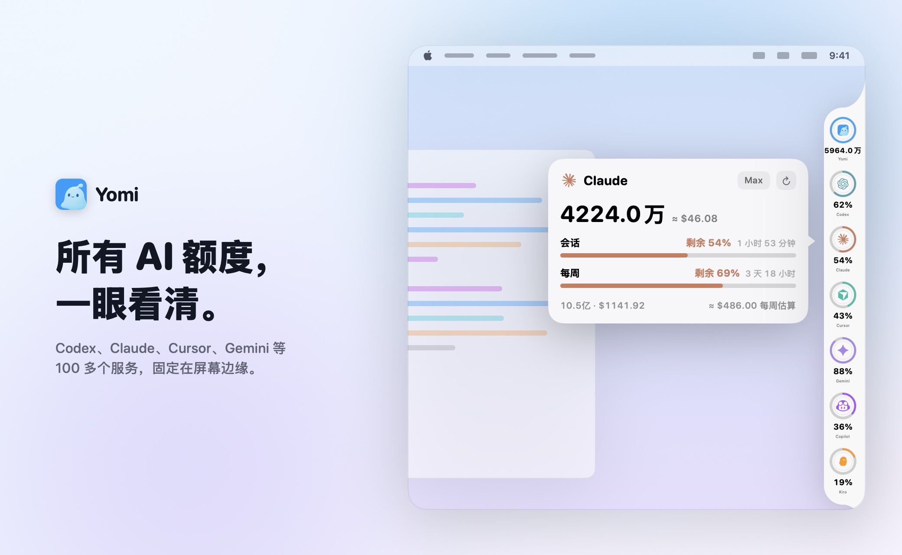

<div align="center">

<a href="https://github.com/Seaony/CodeEdge/releases/latest"></a>

# CodeEdge

### 用到极限，心里有数。

**Codex、Claude、Cursor、Gemini、Copilot、Kiro 等 100 多个服务，固定在屏幕边缘。**<br>
剩余额度、重置时间、今日 Token 和预估花费，<br>
不用再打开任何一个控制台。

[](https://github.com/Seaony/CodeEdge/releases/latest) [](https://github.com/Seaony/CodeEdge/stargazers)<br>
  

**[下载](https://github.com/Seaony/CodeEdge/releases/latest)** &nbsp;·&nbsp; **[发布说明](docs/RELEASING.md)** &nbsp;·&nbsp; [English](README.md) · **简体中文**

<br>

<picture>
  <source media="(prefers-color-scheme: dark)" srcset="docs/assets/product-dark-zh.jpg">
  
</picture>

</div>

<br>

## CodeEdge 适合你吗？

每个 AI 服务把用量放在不同的地方：设置页、命令行、账单后台，或者点三层才能找到的用量标签页。同时订阅好几个时，查剩余额度就成了体力活，而且往往要等请求被拒才发现用完了。

CodeEdge 把这些都收进屏幕边缘的一条细栏里：

- **剩多少一眼就知道**：每个 Provider 是一个圆环，显示剩余额度比例。点开能看到套餐、所有额度窗口和距离重置的时间。
- **花了多少心里有数**：从本地会话日志统计今天和最近 30 天的 Token，按各模型价格算出预估金额。
- **只用真实数据**：额度来自各服务自己的数据源（接口、本机账号、命令行或浏览器会话），从不根据聊天内容或日志去猜。
- **不打扰工作**：可停靠在屏幕左侧或右侧，记住位置，跟随系统、深色或浅色外观。

如果你同时用不止一个 AI 工具或套餐，它适合你。如果只用一个服务、它自己的用量页就够用，那你不需要它。

## 快速开始

**1 · 安装。** 从 **[最新版本](https://github.com/Seaony/CodeEdge/releases/latest)** 下载 DMG，把 `CodeEdge.app` 拖进“应用程序”。

<sub>安装包同时支持 Apple 芯片和 Intel，需要 macOS 26.5 或更高版本。已使用 Developer ID 签名并通过 Apple 公证。CodeEdge 会通过 Sparkle 从 GitHub Releases 自动更新。</sub>

**2 · 启用 Provider。** 打开设置，进入 **Providers**，打开你在用的服务。每一项都会说明需要什么：本机登录、API Key、浏览器会话或环境变量。

**3 · 看一眼。** Provider 返回数据后，圆环就会出现在侧边栏里。拖动侧边栏可以换位置，点圆环看详情，鼠标移到侧边栏底部可以打开设置。

## 支持的 Provider

<table>
<tr><td>

Codex · Claude · Claude Platform · Cursor · Gemini · Antigravity · Copilot · Kiro · xKiro · Windsurf · Amp · Augment · Devin · Droid · JetBrains AI · Zed · Warp · Qoder · Trae CN · CodeRabbit · Codebuff · Command Code · ClinePass · OpenCode · OpenCode Go · Kilo · Muse Code · Pi · WorkBuddy · Raycast · OpenAI · Azure OpenAI · AWS Bedrock · Vertex AI · OpenRouter · DeepSeek · Mistral · Grok · xAI · Groq · Perplexity · Kimi Code · Moonshot · z.ai / GLM · MiniMax · Alibaba · Alibaba Token Plan · Qwen Cloud · Doubao · Xiaomi MiMo · StepFun · LongCat · Fireworks · DeepInfra · Hugging Face · Replicate · fal · Venice · Chutes · Synthetic · Ollama · Poe · T3 Chat · Manus · Notion AI · Sakana AI · Abacus AI · ElevenLabs · Deepgram · Soniox · Tavily · Exa · Linkup · Parallel · Vercel AI Gateway · v0 · LiteLLM · LLM Proxy · ZenMux · ClawRouter · Wayfinder · Bifrost · sub2api · Neuralwatt · Atlas Cloud · Langdock · IBM Bob · GitKraken AI · Nous Portal · Charm Hyper · Chatbox AI · Future AGI · Munito · OpenDesign · abliteration.ai · SiliconFlow · Tripo · 以及更多

</td></tr>
</table>

每个 Provider 按对应服务允许的方式读取：本机账号、命令行、API Key、浏览器会话或自定义接口。设置页会写明每一项需要什么。

## 功能

### 一条侧边栏，而不是一个控制台

侧边栏是一列圆环，每个 Provider 一个，按剩余额度比例填充。它悬浮在屏幕边缘、位于其他窗口之上，切换桌面空间也一直都在。可以拖到任意一侧、任意高度，下次启动会恢复原位。

### 点一下就有详情

点击圆环会打开一张紧凑卡片：套餐、所有额度窗口（会话、5 小时、每周、每月、点数、余额）、各自用了多少，以及什么时候重置。会返回消费或余额的 Provider 也会一并显示。

### 用你自己的日志算 Token 和花费

对会在本机保存会话日志的工具，比如 Codex、Claude Code、Pi 和 DeepSeek，CodeEdge 会统计今天和最近 30 天的 Token，并按各模型价格计算金额。总览圆环把所有 Provider 加在一起。对 Claude，还会估算当前每周额度对应的金额。

### 为 macOS 而做

原生 SwiftUI 与 AppKit。支持系统、深色、浅色外观，以及英文和简体中文。支持登录时启动、自选刷新间隔和应用内更新。

## 隐私

- 密钥和凭据保存在 macOS 钥匙串中。
- 用量缓存、偏好设置和侧边栏位置都只保存在本机。
- 本地会话日志只用于统计 Token 和金额，聊天内容和代码文本不会被解析成额度。
- CodeEdge 只访问各 Provider 自己的数据源，以及用于更新的 CodeEdge GitHub Releases。

## 从源码构建

需要 Xcode 26.6。

```sh
git clone https://github.com/Seaony/CodeEdge.git
cd CodeEdge
xcodebuild -project CodeEdge.xcodeproj -scheme CodeEdge -configuration Debug \
  -derivedDataPath "$PWD/DerivedData" build
open DerivedData/Build/Products/Debug/CodeEdge.app
```

要从干净且已推送的 `master` 发布版本，运行 `scripts/publish-release.sh <版本号>`。脚本会构建通用应用并签名、公证，生成 ZIP、DMG 和 Sparkle appcast，然后打标签并发布 GitHub Release。详细说明见 [docs/RELEASING.md](docs/RELEASING.md)。

## 致谢

Provider 数据逻辑参考 [CodexBar](https://github.com/steipete/CodexBar)。把额度固定在屏幕边缘的想法与 [codenotch](https://github.com/vinzdg/codenotch) 相通。

---

<div align="center">
  <sub>少开一个网页，多留一点注意力给真正重要的工作。</sub>
</div>
